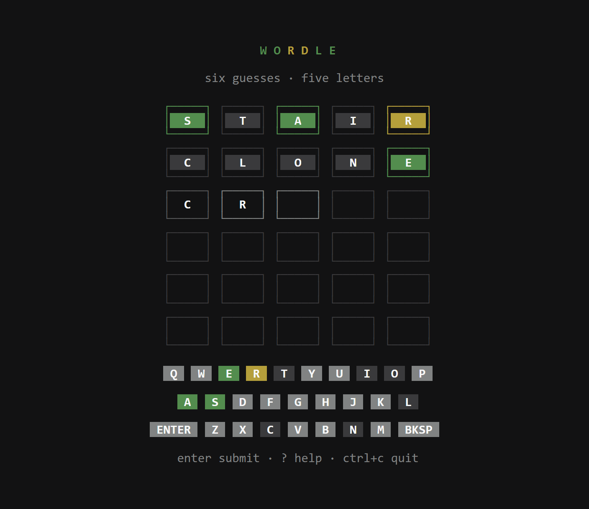

<div align="center">

# wordle

A five-letter word game for the terminal. One random answer per round, six guesses, zero runtime dependencies.

[![release][badge-release]][releases]
[![ci][badge-ci]][ci]
[![license][badge-license]][license]
[![go][badge-go]][gomod]
[![platforms][badge-platforms]][releases]
[![downloads][badge-downloads]][releases]



</div>

## Install

Prebuilt binaries for linux, macos, windows and freebsd — see [releases][releases].

Linux / macOS (amd64; `linux_arm64`, `darwin_arm64`, `freebsd_amd64` and others ship too):

```bash
curl -fsSL https://github.com/epicshawty/wordle-cli/releases/latest/download/wordle_linux_amd64.tar.gz | tar xz
sudo install wordle /usr/local/bin
```

Windows (PowerShell):

```powershell
irm https://github.com/epicshawty/wordle-cli/releases/latest/download/wordle_windows_amd64.zip -OutFile wordle.zip
Expand-Archive wordle.zip -DestinationPath .
```

With Go 1.24 or newer:

```bash
go install github.com/epicshawty/wordle-cli@latest
```

From source:

```bash
git clone https://github.com/epicshawty/wordle-cli
cd wordle-cli && go build -trimpath -o wordle .
```

## Play

| key | action |
| --- | --- |
| `a`–`z` | type a letter |
| `enter` | submit guess |
| `backspace` | delete a letter |
| `?` | key reference |
| `r` | new word, once the round ends |
| `q` `esc` `ctrl+c` | quit |

| flag | effect |
| --- | --- |
| `--word WORD` | play a fixed answer |
| `--plain` | line mode: no TUI, no colour |
| `--no-sound` | mute the cues (also `WORDLE_SOUND=0`) |
| `--version` | print the version |

Piped output is not a terminal, so it switches to line mode on its own:

```console
$ printf 'stair\ncrane\n' | wordle --word crane --plain
1>    S T A I R   . . # . +
2>    C R A N E   # # # # #

Got it in 2/6.
```

## Sound

Cues are on in the TUI, silent in pipes, `--plain` and `WORDLE_SOUND=0`. They are synthesized at runtime — no audio files ship — and still cost no cgo:

| platform | backend | keystroke latency |
| --- | --- | --- |
| Windows | `winmm` `PlaySound`, in-memory | ~5 ms |
| macOS | `afplay` | ~15 ms |
| Linux / BSD | `paplay`, `pw-play` or `aplay`, whichever is on `PATH` | ~10 ms |
| anything else | silent, never an error | — |

A guess plays as a single mixed buffer: one blip per tile at 45 ms intervals, brighter for green, dull for grey, so a one-channel player cannot cut itself off.

## Build for anything

No cgo and no cross toolchain — the target is an environment variable:

```bash
GOOS=linux   GOARCH=arm64  go build -trimpath   # raspberry pi
GOOS=windows GOARCH=amd64  go build -trimpath   # windows
GOOS=darwin  GOARCH=arm64  go build -trimpath   # apple silicon
GOOS=freebsd GOARCH=amd64  go build -trimpath   # freebsd
```

Releases are cut from tags matching `v*.*.*` (semver). Pushing one tag runs `.github/workflows/release.yml`, which builds every target with GoReleaser, writes `checksums.txt` and attaches the archives to a GitHub release.

## Design

| package | job |
| --- | --- |
| `internal/game` | rules only: two-pass scoring so repeated letters are correct, win/loss state |
| `internal/words` | 2,315 words via `go:embed`, used as answers and as valid guesses |
| `internal/ui` | bubbletea/lipgloss board, keyboard, adaptive layout for small terminals |
| `internal/sound` | synthesized cues: winmm on Windows, a system player elsewhere, silence if neither |
| `internal/plain` | line mode for pipes, CI and `--plain` |

The word list is the ENABLE word list (public domain) ranked by OpenSubtitles frequency data (CC BY-SA 4.0) and filtered to five letters.

## License

[AGPL-3.0-or-later](LICENSE) — use it, change it, ship it, but keep it open.

[badge-release]: https://img.shields.io/github/v/release/epicshawty/wordle-cli?style=flat-square&label=release&color=538d4e
[badge-ci]: https://img.shields.io/github/actions/workflow/status/epicshawty/wordle-cli/ci.yml?branch=main&style=flat-square&label=ci
[badge-license]: https://img.shields.io/github/license/epicshawty/wordle-cli?style=flat-square&color=b59f3b
[badge-go]: https://img.shields.io/github/go-mod/go-version/epicshawty/wordle-cli?style=flat-square
[badge-platforms]: https://img.shields.io/badge/platforms-linux%20%7C%20macos%20%7C%20windows%20%7C%20freebsd-538d4e?style=flat-square
[badge-downloads]: https://img.shields.io/github/downloads/epicshawty/wordle-cli/total?style=flat-square&color=538d4e
[releases]: https://github.com/epicshawty/wordle-cli/releases
[ci]: https://github.com/epicshawty/wordle-cli/actions/workflows/ci.yml
[license]: LICENSE
[gomod]: go.mod
